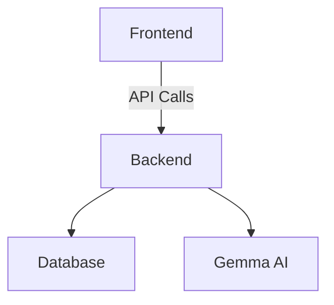

# DamWatch AI

## Overview
DamWatch AI is a web application designed to facilitate the inspection and triage of civil infrastructure, specifically dams, canals, and reservoirs. The application allows users to upload images, provide notes, and specify locations to generate structured inspection reports using AI analysis.

## Features
- **Intake Form**: Users can upload 1-3 images, enter a short note, select an asset from a dropdown, and optionally provide coordinates and water level information.
- **AI Analysis**: The application sends up to three inspection images and field context to Gemma through the Gemini API, then validates the model's structured JSON response before displaying it.
- **Report Card**: Each report includes issue type, severity, visual evidence, recommended actions, and a checklist for next steps.
- **Map Visualization**: A Leaflet map displays the selected asset and all saved reports with color-coded pins based on severity.
- **Before/After Comparison**: Users can compare new images with previously saved reports to detect changes over time.
- **Condition Timeline**: A dedicated comparison flow sends earlier and newer inspection images to Gemma and reports whether visible conditions are stable, improving, or worsening.
- **Demo Mode**: A toggle feature allows users to replay cached responses for demonstration purposes without needing an active API connection.

## Tech Stack
- **Frontend**: React, Vite, Tailwind CSS, Leaflet, OpenStreetMap
- **Backend**: FastAPI, Pydantic v2, SQLite
- **AI Integration**: Gemini API with Gemma, using multimodal inline image data

## Setup Instructions
1. **Backend Setup**:
   - Navigate to the backend directory and install dependencies:
     ```
     cd backend
     pip install -r requirements.txt
     ```
   - Start the backend server:
     ```
     uvicorn app.main:app --host 0.0.0.0 --port 8000
     ```

2. **Frontend Setup**:
   - Navigate to the frontend directory and install dependencies:
     ```
     cd frontend
     npm install
     ```
   - Start the frontend development server:
     ```
     npm run dev
     ```

## Architecture


## Environment Variables
Create a `.env` file in the backend directory based on the `.env.example` provided. Ensure to set the following variables:
- `GEMINI_API_KEY`: Your API key for accessing the Gemini API.
- `GEMMA_MODEL`: The Gemma model to use for analysis (default: `"gemma-4-26b-a4b-it"`).

The backend uses the Gemini `generateContent` endpoint with inline image data.
It does not expose the API key to the frontend. If the key is missing, the API
returns a clear configuration error instead of producing a placeholder report.

## Smoke-Test
To test the `/api/analyze` endpoint, you can use the following curl command:
```
curl -X POST http://localhost:8000/api/analyze -F "images=@image1.jpg" -F "images=@image2.jpg" -F "note=Check for seepage" -F "asset=Dam Name" -F 'coordinates={"lat":12.34,"lon":56.78}' -F "water_level=Normal"
```

## Contribution
Feel free to contribute to the project by submitting issues or pull requests. For any questions, please reach out to the project maintainers.

## License
This project is licensed under the MIT License. See the LICENSE file for more details.