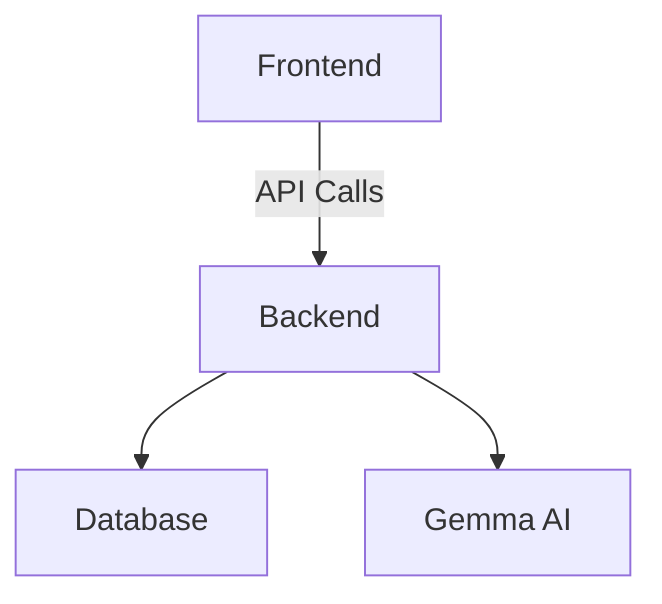

# DamWatch AI

> Multimodal visual change detection for dam and civil-infrastructure inspections.

[](LICENSE)

## Overview
DamWatch AI helps inspection teams notice infrastructure changes earlier. Upload
field imagery and context to generate a structured preliminary triage report, or
compare an earlier and newer photo of the same location to identify visible
changes and recommend the next field action.

This project is an open-source AI application built for the MLH Hacktoberfest
Hack Day. It is not a safety certification or an engineering assessment.

## Features
- **Intake Form**: Users can upload 1-3 images, enter a short note, select an asset from a dropdown, and optionally provide coordinates and water level information.
- **AI Analysis**: The application sends up to three inspection images and field context to Gemma through the Gemini API, then validates the model's structured JSON response before displaying it.
- **Report Card**: Each report includes issue type, severity, visual evidence, recommended actions, and a checklist for next steps.
- **Condition Timeline**: Compare earlier and newer inspection images to classify visible observations as worsened, improved, or unchanged.
- **Map Visualization**: A Leaflet map displays the selected asset and all saved reports with color-coded pins based on severity.
- **Condition Timeline**: A dedicated comparison flow sends earlier and newer inspection images to Gemma and reports whether visible conditions are stable, improving, or worsening.
- **Demo Mode**: A toggle feature allows users to replay cached responses for demonstration purposes without needing an active API connection.

## Tech Stack
- **Frontend**: React, Vite, Tailwind CSS, Leaflet, OpenStreetMap
- **Backend**: FastAPI, Pydantic v2, SQLite
- **AI Integration**: Gemini API with Gemma 4, using multimodal inline image data

## AI contribution

Gemma performs the core multimodal reasoning:

1. It receives inspection images plus human-entered notes and water-level context.
2. It identifies only visible evidence and reports uncertainty through evidence strength and data gaps.
3. In timeline mode, it receives an older and newer image and explains visible changes.
4. The backend validates the model output against Pydantic schemas before the frontend renders it.

The app uses the open-weight Gemma family through the Gemini API. See the
[Gemma model overview](https://ai.google.dev/gemma/docs/core) and
[Gemini API terms](https://ai.google.dev/gemini-api/terms) for model and service
terms. The exact model is configured with `GEMMA_MODEL`.

## Setup Instructions
1. **Backend Setup**:
   - Navigate to the backend directory and install dependencies:
     ```
     cd backend
     pip install -r requirements.txt
     ```
   - Start the backend server:
     ```
     uvicorn app.main:app --host 0.0.0.0 --port 8000
     ```

2. **Frontend Setup**:
   - Navigate to the frontend directory and install dependencies:
     ```
     cd frontend
     npm install
     ```
   - Start the frontend development server:
     ```
     npm run dev
     ```

## Try the app

Open `http://localhost:3000/`, choose an inspection image, select an asset, and
add a short note. For the differentiating demo, choose **Compare timeline** and
upload an earlier and newer image of the same location.

Sample test images are included in [`data/samples/`](data/samples/). Demo report
fixtures are in [`data/demo_cache/`](data/demo_cache/).

## Architecture


## Environment variables
Create a `.env` file in the backend directory based on the `.env.example` provided. Ensure to set the following variables:
- `GEMINI_API_KEY`: Your API key for accessing the Gemini API.
- `GEMMA_MODEL`: The Gemma model to use for analysis (default: `"gemma-4-26b-a4b-it"`).

The backend uses the Gemini `generateContent` endpoint with inline image data.
It does not expose the API key to the frontend. If the key is missing, the API
returns a clear configuration error instead of producing a placeholder report.
Never commit `backend/.env`; it is excluded by `.gitignore`.

## Smoke-Test
To test the `/api/analyze` endpoint, you can use the following curl command:
```
curl -X POST http://localhost:8000/api/analyze -F "images=@image1.jpg" -F "images=@image2.jpg" -F "note=Check for seepage" -F "asset=Dam Name" -F 'coordinates={"lat":12.34,"lon":56.78}' -F "water_level=Normal"
```

## Contribution
Contributions are welcome through issues and pull requests. Please keep model
outputs grounded in visible evidence and preserve the preliminary-triage
disclaimer when changing the user experience.

## License
This project is licensed under the MIT License. See the LICENSE file for more details.